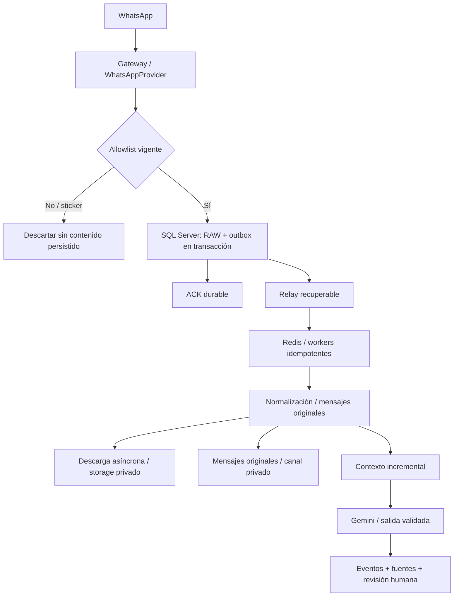

# Arquitectura de Mensajero

## Alcance y decisiones

Monolito modular Laravel 13 / PHP 8.4, SQL Server como única base operativa,
Redis para colas, sesiones y cache; gateway Node.js/TypeScript independiente.
UTC en persistencia y America/Mexico_City en presentación.

**Problema:** operación pequeña con evidencia permanente y futura interpretación contextual.
**Opciones:** SPA Inertia/Vue o Blade/Livewire/Alpine.
**Ventajas de Blade/Livewire:** autorización y consultas en PHP, menor duplicación del dominio.
**Desventajas:** interacciones dependientes del servidor.
**Riesgos:** consultas repetidas y saturación si se usa polling indiscriminado.
**Decisión:** Blade + Livewire + Alpine, con broadcasting privado en milestone 8.
El inicio de sesión utiliza formularios Blade convencionales. No se requiere Horizon;
workers Redis supervisados en Linux son suficientes inicialmente.

## Límites de módulos

Identity: usuarios, roles y acceso por chat. Connections: estado e historial del proveedor.
Capture: allowlist, RAW inmutable, deduplicación y outbox. Messages: proyección consultable.
Media: archivos privados, metadata, reintentos y salud. Intelligence: contextos, análisis,
eventos y fuentes. Audit: actor, acción, fecha, motivo y cambios, sin secretos.

RAW nunca se sobrescribe por normalización, eliminación remota o IA. Una edición o
revocación es otro evento enlazado al mensaje. El usuario de aplicación no tendrá permisos
de borrar evidencia; las migraciones usarán otra identidad. Backups SQL y storage coherentes,
restauraciones ensayadas y retención sin purga automática hasta definir política empresarial.

## Garantías y límites

ACK solamente después de confirmar RAW y outbox en SQL. Redis no es la única copia de trabajo
pendiente. El relay puede publicar repetidamente; cada consumidor debe ser idempotente.
Si SQL falla: 503, no ACK y reintento del gateway. Si Redis falla: captura durable continúa.
No es posible prometer cero pérdida antes de que el proveedor entregue el evento ni recuperar
siempre archivos expirados. Medir y alertar esos intervalos, no ocultarlos.

Filtrado doble: gateway antes de descargas o spool y backend antes de RAW. Ante allowlist
desconocida, no procesar contenido. Consultar de nuevo y pedir redelivery si el proveedor lo
permite. Disponibilidad y privacidad entran en conflicto durante una desconexión: prevalece
no capturar chats no autorizados; registrar la brecha sin contenido.
