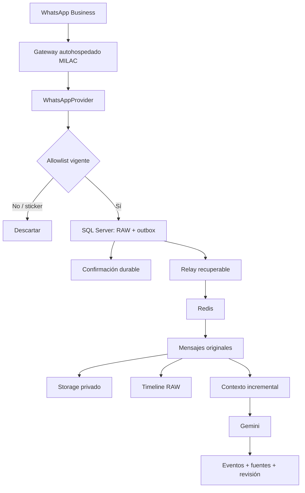

# Arquitectura de Mensajero

## Decisiones vigentes

Monolito modular Laravel 13 / PHP 8.4, SQL Server como única base operativa y Redis para
colas/cache. Blade + Livewire + Alpine en la aplicación principal. El único componente
separado será el gateway WhatsApp Node.js/TypeScript cuando la captura real lo requiera.

Mensajero se instalará en servidor propio de MILAC y sus tablas convivirán dentro de una base
SQL Server corporativa existente. Ningún objeto nuevo utilizará nombres genéricos: tablas,
historial de migraciones y estructuras persistentes propias usan prefijo `mensajero_`.

Temporalmente `MENSAJERO_AUTH_MODE=disabled`. Las rutas del producto pasan por un middleware
propio; cuando el modo sea `corporate`, el sistema falla cerrado mientras no exista el adaptador.
Así la ausencia temporal de login no queda mezclada con controladores o lógica de negocio.

## Garantía de captura

`CaptureIncomingWhatsappEvent` consulta y bloquea la fila de allowlist dentro de la misma
transacción que crea RAW y outbox. Un chat desconocido/no monitoreado/inactivo o un sticker
termina antes de persistir contenido. El mismo evento usa una clave SHA-256 de deduplicación;
los índices SQL protegen carreras y reintentos.

RAW y outbox se confirman juntos. Redis no participa en esa transacción y por tanto una caída
de Redis no debe causar pérdida de evidencia ya recibida. El relay futuro puede duplicar
entregas, pero los consumidores deberán ser idempotentes.

## WhatsApp

No se adoptará un proveedor administrado/SaaS. Los grupos actuales tienen alrededor de 30 o
más participantes y ya existen; no se asume que la Groups API oficial pueda consumirlos.
Se utilizará una integración WhatsApp Web autohospedada detrás de `WhatsAppProvider`.
La librería concreta es reemplazable y no puede contener reglas de transporte, Gemini ni
acceso directo al dominio.

No conectar el número productivo antes de probar una sesión controlada.

## Datos y archivos

SQL Server: conexiones, chats/allowlist, contactos, RAW, outbox, mensajes, metadata y rutas.

Storage/Flysystem: fotos, video, audio, documentos y cualquier binario. Las rutas guardadas
son relativas a un `disk`; nunca rutas absolutas del servidor.
